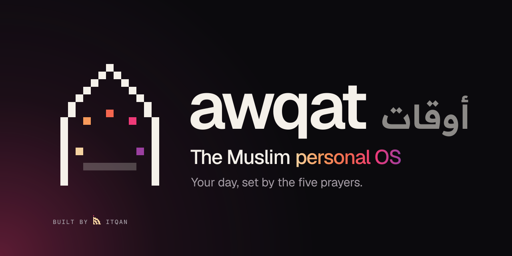
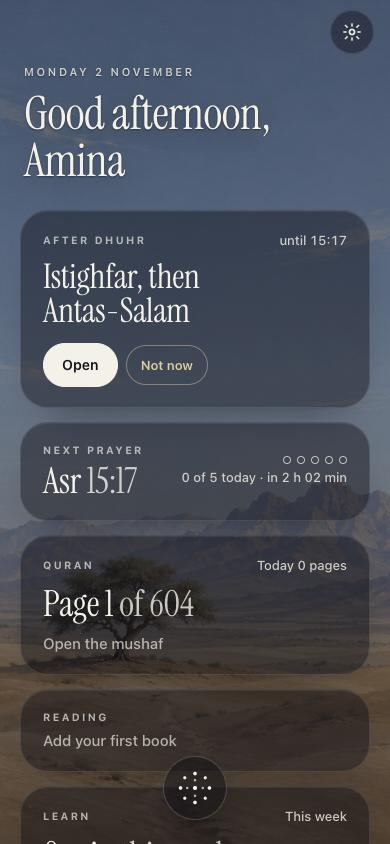
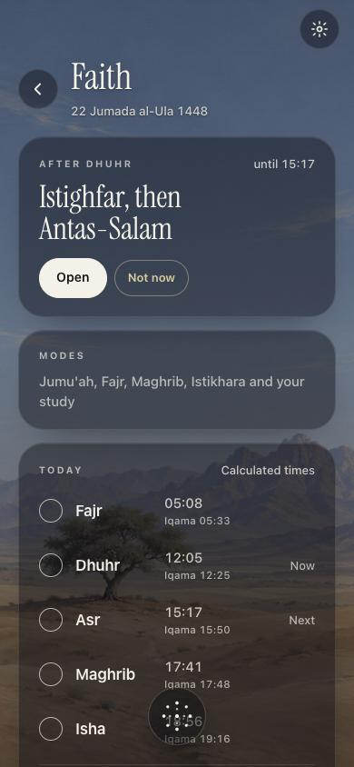

<p align="center">
  
</p>

# Awqat

Awqat (أوقات, "the times") is a personal OS for Muslims: a calm phone app that runs your day on the five prayer
times. Prayer, Quran, dhikr, study, books, body and money live in one place, and the screen changes with the time of
day. After Fajr it opens on the morning adhkar, on Friday it asks about Al-Kahf, and after Isha it brings up what you
set yourself to study.

It is built with Capacitor and plain TypeScript for Android, iPhone and iPad. Your records stay on your phone. There
is no account, no server of ours, no analytics and no ads.

<p align="center">
  
  &nbsp;
  
</p>

## What it does

**Prayer.** Times worked out on the phone with [adhan-js](https://github.com/batoulapps/adhan-js), for where you are
or for coordinates you type, with the calculation method chosen for your time zone or by you. The iqama after each
adhan, with your mosque's minutes. A reminder at each prayer, and a log of what you prayed, on time or late, with
Duha, Witr and night prayer, and the prayers you owe.

**Modes.** The app opens what the time calls for: the dhikr after the salam after each prayer, the morning adhkar after
Fajr until half an hour after sunrise, Maghrib's evening adhkar, Jumu'ah from Maghrib on Thursday, and Istikhara when
you need it. Each count has a tap ring, and the tasbih goes to a hundred.

**Quran.** A Madinah mushaf reader, all 604 pages, drawn from the King Fahd Complex page fonts (see "No Quran word is
typed" below). Pages turn like a book's, with notes on an ayah or a page, a bookmark that follows your reading, a
daily goal, and a muraja'ah (revision) plan by juz. The whole mushaf can be downloaded for offline reading.

**Recite.** Tap the microphone in the mushaf, recite three or four words of any ayah, and its page opens with the ayah
lit. Or tap Memorise under a page: its words go blank, keeping their places, and fill in as you recite; a word heard as
another, or skipped, is marked, and the slips can be kept for revision. A Quran speech model runs on the phone after a
one-time download of about 46 MB, and nothing you recite leaves it. Words are checked, not tajweed. How it works:
[docs/recitation.md](docs/recitation.md).

**Learning.** Tracks for Tafsir, Hadith and Fiqh to start with, plus any of your own, each with a weekly target, a
study timer, lessons to review, and a window after the prayer you choose.

**Books.** A reading list with a barcode scanner, Open Library covers, pages read, lessons and notes, and a Goodreads
import.

**The rest of the day.** Your calendars (any iCal address), Body (weight, steps, sleep and workouts from Health
Connect or Apple Health, read only), Money (income, spending and what is owed, in AED and USD for now), and a Weekly
Review with separate numbers and never one score.

**On the lock screen.** Home-screen widgets for the next prayer with a countdown and a dhikr counter that works with
the app closed. On iPhone, Live Activities and the Dynamic Island. On Android, Live Updates.

**Optional, with your own server.** A voice assistant you can talk to about your day, sync between your devices, and
Work and Inbox feeds. These need a backend you run yourself. See [docs/backend.md](docs/backend.md). Without one,
they stay out of the way.

## No Quran word is typed

Nothing of the Quran is typed by hand, generated, or bundled in the app. The mushaf is drawn with the King Fahd
Complex's page fonts (QPC V2, the 1421 print), downloaded once from Quran Foundation's servers and checked against a
list of hashes before use, so a changed or damaged font never draws a page. A page's words come from Quran
Foundation's API when the page is opened and are kept for at most seven days, as its developer terms allow. Where a
dhikr is an ayah (Ayat al-Kursi, the last three surahs), the app opens that page of the mushaf instead of printing it.

## Build it

You need Node 22 or newer. For Android, JDK 21 and the Android SDK. For iPhone and iPad, a Mac with Xcode.

```bash
git clone https://github.com/ibrahimshareef96-sys/awqat.git
cd awqat
npm ci
npm test          # 1,300+ tests, run on the Asia/Dubai clock so the expected prayer times hold
npm run build
npx cap sync
```

Then open `android/` in Android Studio, or `ios/App/App.xcodeproj` in Xcode, and run it on a device. From the command
line, `npm run apk` builds a debug APK in `android/app/build/outputs/apk/debug/`.

If something does not build: `npm ci` again after changing branches; JDK 21 must be the one Gradle finds
(`./gradlew --version`); in Xcode, set your own team on both targets before running on a device.

### Working with a coding agent

Point Claude Code, Codex or any agent at [AGENTS.md](AGENTS.md) first (Claude Code reads it through
[CLAUDE.md](CLAUDE.md) on its own). It holds the ground rules, the commands, the layout of the code and the steps for
adding a feature, so an agent can make a change that keeps what Awqat promises.

Before you publish a build of your own, change the app id `app.awqat` (in `capacitor.config.ts`,
`android/app/build.gradle` and the Xcode project) and the iOS App Group `group.app.awqat`, and set your own Apple
team in Xcode. Release signing on Android reads `android/keystore.properties` or the file named by
`AWQAT_KEYSTORE_PROPS`; neither is ever committed.

Settings that live in `.env.local` (see `.env.example`):

- `VITE_WORKER_URL`: a backend to use by default for the optional features. Users can also type one in Settings.
- `VITE_ADHAN=1`: only in a build that ships adhan recordings. See [docs/adhan.md](docs/adhan.md).

## Privacy

Out of the box Awqat talks to no server of its own. It reaches public services only for what you ask of it: Quran
Foundation for the mushaf's fonts and words, Open Library when you scan or look up a book, the calendar addresses you
add, and, when you first use recitation, Hugging Face and the Tanzil Project for the speech model and the Quran text.
Your voice is heard on the phone and never sent anywhere. Your location is rounded to about a kilometre and stays on the phone, unless you use Talk, which sends it to
Open-Meteo for the weather. Health data is only read; today's step count is kept for the widget. The details are in
[public/privacypolicy.html](public/privacypolicy.html). If you publish a build with Talk or sync turned on, update the
iOS privacy manifests (`PrivacyInfo.xcprivacy`) to match.

## Credits

Prayer times by adhan-js (MIT). Morning and evening adhkar from Seen Arabic's
[Morning-And-Evening-Adhkar-DB](https://github.com/Seen-Arabic/Morning-And-Evening-Adhkar-DB) (MIT), from Hisn
al-Muslim. Quran fonts provided by [Quran Foundation](https://quran.foundation), in the King Fahd Complex's script.
Quran metadata, and the text recitation matches against, from the [Tanzil Project](https://tanzil.net). The Quran
speech model is [Tarteel AI](https://tarteel.ai)'s Whisper Tiny for Quran (Apache-2.0), run with transformers.js and
ONNX Runtime. Type: Instrument Serif (SIL OFL 1.1). Weather from
[Open-Meteo](https://open-meteo.com) (CC BY 4.0). Book data from [Open Library](https://openlibrary.org).
Full notices: [THIRD_PARTY_NOTICES.md](THIRD_PARTY_NOTICES.md).

## How it was made

Awqat is built by [Itqan Studio](https://itqanstudio.com). It started as one person's private app, built with AI coding
agents (Claude Code), then reviewed by Codex and Kimi before release for anything personal, anything licensed, and
anything a stranger would trip on. What is planned next
is in [ROADMAP.md](ROADMAP.md).

## Licence

The code, the sky paintings and the brand are MIT licensed (see [LICENSE](LICENSE)). Third-party data, fonts and
libraries keep their own licences, listed in [THIRD_PARTY_NOTICES.md](THIRD_PARTY_NOTICES.md).
