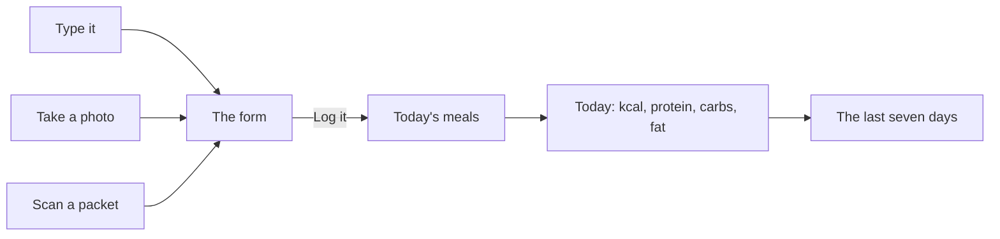

# Food: meals, packets and photos

Food lives on the Body screen, under Training. It answers one question: what did I eat today, and what does it add up
to. It never grades a day.

## Three ways to log a meal



1. **Type it.** A name and the energy in kcal. Protein, carbs and fat are optional.
2. **Take a photo.** The photo is kept beside the meal so you can see what you ate. You still type the numbers, unless
   you run your own server (below).
3. **Scan a packet.** The camera reads the barcode on the phone. The app asks Open Food Facts what 100 g of that
   product holds, you type the grams you ate, and the app works out the rest.

Goals are yours: a day's energy in kcal, a day's protein in grams, either or neither. The app suggests none. Ask a
dietitian or a doctor for numbers that fit you.

## What leaves the phone

| What | Goes where | When |
|---|---|---|
| A packet's barcode (digits only) | Open Food Facts | When you scan a packet |
| A meal's photo | Your own server, if you set one up | Only when you tap "Estimate from the photo" on that photo |
| Everything else (meals, goals, photos) | Nowhere | Never, unless you turn on sync with your own server. Photos never sync |

A photo is redrawn before it is saved, so the camera's location and details are not in the file. It is kept in the
app's own folder (`meals/`), not your gallery, and deleted when you remove its meal on that phone or clear the form.
A meal removed on another device leaves its photo behind for a day or two, until the app next starts and clears it.
On iOS the folder is part of the user's own device backup. Open Food Facts, like any website, sees the phone's
internet address along with the barcode.

## How it is built

| File | What |
|---|---|
| `src/food/food.ts` | The log: meals, goals, a day's totals, a packet's portion, reading a saved log back |
| `src/food/draft.ts` | The meal still on the form, and turning it into a meal (every way a form can be wrong) |
| `src/food/packet.ts` | The Open Food Facts lookup, checked field by field |
| `src/food/estimate.ts` | The optional estimate from your own server |
| `src/food/phone.ts` | The camera, the scanner and the photo files |
| `src/app/foodActions.ts`, `src/ui/foodView.ts` | What a tap does, and the card on Body |

Tests: `test/food.test.ts`, `test/foodPacket.test.ts`, `test/foodActions.test.ts`, `test/foodView.test.ts`.

## Estimating a meal from its photo (optional, your own server)

Telling calories from a picture needs a vision model. No model small enough to ship in a phone app does this well, so
Awqat does not pretend to. If you run the optional backend ([backend.md](backend.md)), add one route and the app shows
an "Estimate from the photo" button once a photo is on the form.

**The request.** `POST /app/food/estimate`, with `Authorization: Bearer <session>` and a JSON body:

```json
{ "image": "<the JPEG in base64, at most about 1.5 MB>" }
```

**The answer.** One of:

```json
{ "ok": true, "name": "Chicken and rice", "kcal": 620, "protein": 41, "carbs": 68, "fat": 17 }
```

```json
{ "ok": true, "unsure": true }
```

`kcal` is a number from 0 to 10,000. `protein`, `carbs` and `fat` are grams from 0 to 1,000, or `null` when the model
cannot tell. Answer `unsure` when the picture is not food. A `401` tells the app the session ended.

**What your server does.** Check the session, pass the image to a vision model you have an account with, and ask it
for exactly that JSON. A prompt that works: "This is a photo of one meal. Name it in a few words. Estimate the energy
in kcal and the protein, carbohydrate and fat in grams for the portion shown. Answer only with JSON: name, kcal,
protein, carbs, fat. If it is not food, answer {\"unsure\": true}." Check the model's answer is that shape before
you send it on, and do not keep the image.

**What the app does with it.** It checks every field again (`parseEstimate` in `src/food/estimate.ts`), fills the form,
and says it is an estimate. Nothing is logged until you read it, correct it and tap Log it. An estimate from a photo
can be far off: a model cannot see oil, sugar or how deep the bowl is.
