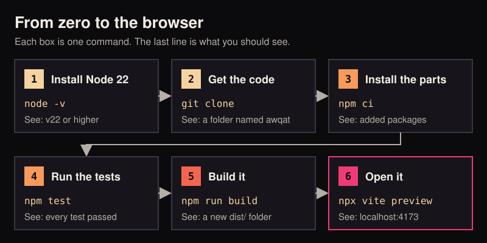
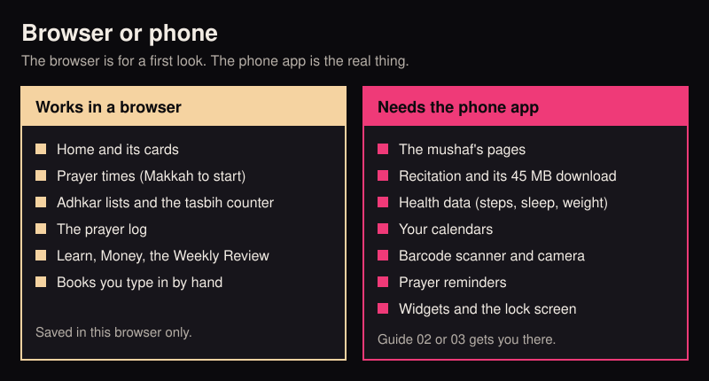

# 01 Run it

By the end of this guide Awqat is open in a browser on your computer. You will have run its tests and built it once.
Nothing here needs a phone.

<p align="center">
  
</p>

## Before you start

You need two free tools.

- **Node.js**, version 22 or newer. Node runs the commands that test and build Awqat. Get it from
  [nodejs.org](https://nodejs.org/en/download).
- **Git**. Git copies the repository to your computer. Get it from [git-scm.com](https://git-scm.com/downloads). A
  Mac offers to install it the first time you type `git`.

**On Windows, type every command in Git Bash**, not in PowerShell or Command Prompt. Git Bash is installed with Git.
Two of Awqat's commands (`npm test` and `npm run apk`) are written in a way only a Unix-style terminal understands.

## Steps

### 1. Check Node

Open a terminal and type:

```bash
node -v
```

You should see a version number that starts with `v22` or higher, for example `v24.14.0`.

If you see "command not found", Node is not installed yet. Install it, close the terminal, open a new one and try
again.

### 2. Get the code

```bash
git clone https://github.com/ibrahimshareef96-sys/awqat.git
cd awqat
```

You should see Git count up some objects, then a new folder named `awqat`. The second line moves you into it. Every
command after this is typed inside that folder.

No Git? On the repository's GitHub page you can choose Code, then Download ZIP, and unzip it. GitHub explains this in
[Downloading source code archives](https://docs.github.com/en/repositories/working-with-files/using-files/downloading-source-code-archives).

### 3. Install the parts

```bash
npm ci
```

This downloads the libraries Awqat is built from into a folder named `node_modules`. It reads the exact list in
`package-lock.json`, so you get the same versions as everyone else.

You should see a line that starts with `added` and ends with `packages` after a minute or so. Lines that start with `npm warn` are fine.
A line that starts with `npm error` is not.

### 4. Run the tests

```bash
npm test
```

Tests are small programs that check the app's logic still gives the right answers. Awqat has more than 1,300 of them.
They run on the Asia/Dubai clock on purpose, so the expected prayer times are the same on every computer.

You should see a list of test files with a tick beside each, and a last line that says how many passed, with none
failed.

### 5. Build it

```bash
npm run build
```

This checks the code for type mistakes, then packs the app into a new folder named `dist`.

You should see a list of files with their sizes and a line that says `built in` a few seconds. A new `dist` folder
now sits in the repository.

### 6. Open it

```bash
npx vite preview
```

You should see:

```
Local:   http://localhost:4173/
```

Open that address in your browser. Awqat's Home screen appears, with the date at the top, a greeting, the next prayer,
and a card that offers to set up your location and reminders. Until you set a place, the times shown are Makkah's.

The app is made for a phone, so it looks best in a narrow window. Drag the browser window to about the width of a
phone.

To stop, go back to the terminal and press `Ctrl` and `C` together.

> Use `npx vite preview`, not `npm run dev`, for a look at the app. Awqat's page has a strict security policy that
> refuses styles added on the fly, which is how the dev server adds them. Under `npm run dev` the app works but shows
> as plain unstyled text.

## What the browser cannot do

The browser is a first look. It is not the app. Awqat is made to live on a phone, and many parts lean on things only
a phone has.

<p align="center">
  
</p>

| In a browser | What happens |
|---|---|
| The mushaf | Each page says "This page did not load". Pages are fetched and kept by the phone app only. |
| Recitation | It says "Reciting works in the installed app." The speech model, about 45 MB, downloads on a phone only. |
| Body | It says "Body reads your health data in the installed app." Health Connect and Apple Health exist only on phones. |
| Agenda | It says "Agenda reads calendars in the installed app." |
| The meaning and sound of adhkar | Not fetched. The Arabic text of the bundled adhkar still shows. |
| Barcode scanner and camera | Made for the phone. Do not count on them in a browser. |
| Prayer reminders | None. A browser tab cannot ring at Fajr. |
| Widgets, the lock screen, Live Activities | None. These are drawn by Android and iOS, not by the page. |
| Talk, sync and the feeds | These need your own server, and the phone app. See [docs/backend.md](../backend.md). |

What you type in the browser is saved in that browser only. It does not move to a phone later.

## Common errors

| You see | What to do |
|---|---|
| `node: command not found` | Install Node, then open a new terminal. |
| `'TZ' is not recognized as an internal or external command` | You are in PowerShell or Command Prompt on Windows. Use Git Bash. |
| `npm error code EUSAGE` during `npm ci` | You are not inside the `awqat` folder. Type `cd awqat` first. |
| Tests fail right after a fresh clone | Run `npm ci` again, then `npm test`. If they still fail, open an issue with the output. |
| `npx vite preview` shows a blank page or an error about `dist` | Run `npm run build` first. Preview serves the `dist` folder. |
| `Port 4173 is in use` | Another preview is still running. Vite picks the next free port and prints it. Use that address. |
| The app shows as plain text with no colours | You ran `npm run dev`. Stop it, then use `npm run build` and `npx vite preview`. |

## Next

- An Android phone: [02 Android](02-android.md).
- An iPhone or iPad: [03 iPhone and iPad](03-iphone-ipad.md).
- Prefer to have an agent do this with you: [05 With a coding agent](05-with-a-coding-agent.md).
