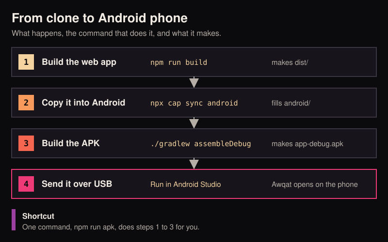
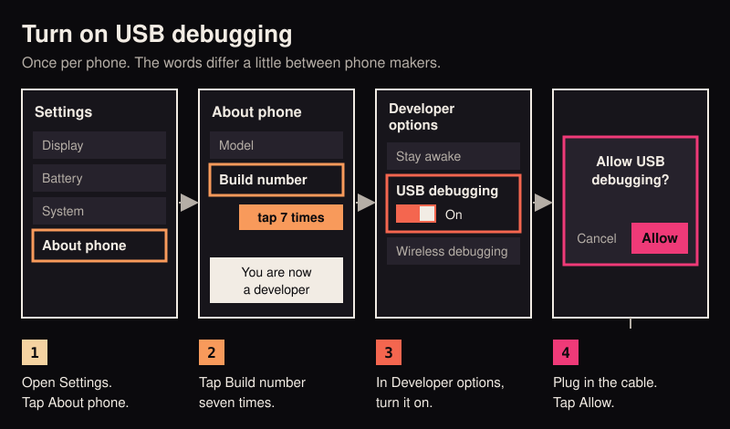
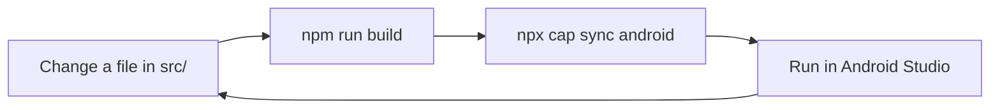
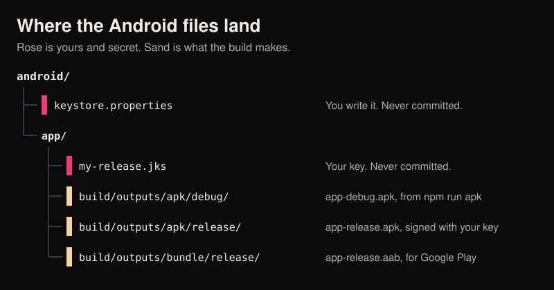

# 02 Android

By the end of this guide Awqat is installed on your Android phone, built by you from the source.

Do [01 Run it](01-run-it.md) first. This guide starts where it ends: the code is on your computer, `npm ci` has run,
and `npm run build` works.

<p align="center">
  
</p>

## Before you start

| You need | Why | Where |
|---|---|---|
| An Android phone on Android 8.0 or newer | Awqat's lowest supported version | Android 8.0 came out in 2017, so most phones in use qualify |
| A USB cable that carries data | Some cables only charge | The one that came with the phone is the safe choice |
| JDK 21 | Java 21, the language Android's build tool runs on | [Adoptium Temurin](https://adoptium.net/temurin/releases/), pick version 21 |
| Android Studio | Google's app for building Android apps. It brings the Android SDK, the kit of parts every Android build needs | [developer.android.com/studio](https://developer.android.com/studio) |

On Windows, keep using Git Bash for the commands, as in guide 01.

An emulator (a pretend phone on your screen) is not the easy path here. Awqat is built for the chip real phones use,
called arm64. An emulator on an Intel or AMD computer uses a different chip and will refuse to install it. A real
phone always works.

## Part 1: set up the computer

### 1. Install JDK 21 and check it

Install it, open a new terminal, and type:

```bash
java -version
```

You should see a line with `21` in it, for example `openjdk version "21.0.5"`.

### 2. Install Android Studio

Run the installer and accept the standard setup. On first launch it downloads the Android SDK. Let it finish.

You should see the "Welcome to Android Studio" window.

### 3. Add Android SDK Platform 36

Awqat is built against Android 16, which the tools call API level 36.

In Android Studio, open More Actions, then SDK Manager. On the SDK Platforms tab, tick the row with API level 36 and
press Apply.

You should see "Installed" in the Status column of that row.

## Part 2: set up the phone

<p align="center">
  
</p>

USB debugging lets your computer install apps on the phone through the cable. It is off until you turn it on.

### 4. Turn on Developer options

On the phone, open Settings, then About phone. Find Build number and tap it seven times. On some phones it is under
About phone, then Software information.

You should see a short message: "You are now a developer".

### 5. Turn on USB debugging

Go back to Settings. Open System, then Developer options. On some phones Developer options sits at the bottom of the
main Settings list. Turn on USB debugging.

You should see the switch stay on after you confirm.

### 6. Plug in and allow

Connect the phone to the computer with the cable and unlock the phone.

You should see a question on the phone: "Allow USB debugging?". Tick "Always allow from this computer" and tap Allow.

Google's own pages cover the differences between phone makers:
[Configure on-device developer options](https://developer.android.com/studio/debug/dev-options) and
[Run apps on a hardware device](https://developer.android.com/studio/run/device).

## Part 3: build and run

### 7. Copy the web app into the Android project

In the terminal, inside the `awqat` folder:

```bash
npm run build
npx cap sync android
```

`cap` is Capacitor, the tool that wraps the web page in a phone app. `sync` copies the `dist` folder into `android/`
and lines up the native plugins.

You should see a list of steps with ticks, ending in `Sync finished`.

### 8. Open the project in Android Studio

```bash
npx cap open android
```

Or open Android Studio, choose Open, and pick the `android` folder inside `awqat`. Pick `android`, not `awqat`.

The first time, Android Studio downloads Gradle (the build tool) and many libraries. This can take several minutes.

You should see "Gradle sync finished" at the bottom, and your phone's name in the device menu at the top.

### 9. Run

Press the green Run button, the triangle at the top.

You should see Awqat open on your phone. It will ask for your rough location and for notifications. Both are optional,
and you can answer "Not now".

That is the whole loop. When you change something in `src/`, do steps 7 and 9 again.



## Just the APK, no Android Studio window

An APK is the single file an Android phone installs an app from. One command makes it:

```bash
npm run apk
```

This runs the build, the sync and the Android build one after the other. The first run is slow.

You should see `BUILD SUCCESSFUL`, and this file:

```
android/app/build/outputs/apk/debug/app-debug.apk
```

Copy that file to any Android phone (a cable, a cloud drive, a message to yourself) and open it there. The phone asks
you to allow installs from that source once. This is a debug build. It is signed with a throwaway key that lives on
your computer, which is fine for your own phone and not accepted by Google Play.

`npm run apk` needs to know where the Android SDK is. Opening the project in Android Studio once (step 8) writes that
down for you, in a file named `android/local.properties`.

<p align="center">
  
</p>

## A release build, signed with your own key

Do this when you want to give the app to other people or put it on Google Play. Before that, give the app your own
app id. See [04 Make it yours](04-make-it-yours.md).

Signing stamps the app with a key only you hold. Android uses it to check that an update comes from the same person
as the app already installed.

### 1. Make a key, once

```bash
cd android/app
keytool -genkeypair -v -keystore my-release.jks -keyalg RSA -keysize 2048 -validity 10000 -alias awqat
cd ../..
```

`keytool` comes with the JDK. It asks for a password and a few questions about you.

You should see a new file, `android/app/my-release.jks`.

### 2. Tell the build where the key is

Make a new text file at `android/keystore.properties` with these four lines, using your own passwords:

```properties
storeFile=my-release.jks
storePassword=the-password-you-chose
keyAlias=awqat
keyPassword=the-password-you-chose
```

`storeFile` is read from the `android/app` folder. A full path to a file kept somewhere else works too.

If you would rather keep this file outside the repository, set the environment variable `AWQAT_KEYSTORE_PROPS` to its
full path instead. The build reads that first.

### 3. Build

```bash
npm run sync
cd android
./gradlew assembleRelease
cd ..
```

You should see `BUILD SUCCESSFUL` and the file `android/app/build/outputs/apk/release/app-release.apk`.

For Google Play, which wants a bundle and not an APK, use `./gradlew bundleRelease`. It makes
`android/app/build/outputs/bundle/release/app-release.aab`.

### Keep the key safe

- **Never commit it.** The repository's `.gitignore` already leaves out `keystore.properties`, `*.jks` and
  `*.keystore`. Type `git status` after making them. You should not see either file listed.
- **Never paste the passwords** into a chat, an issue or a coding agent.
- **Keep a copy somewhere safe.** If you lose the key, you cannot ship an update that installs over your own app.

Without a `keystore.properties`, a release build still finishes, but the APK is unsigned and no phone will install
it. Google explains signing in full in [Sign your app](https://developer.android.com/studio/publish/app-signing).

## Common errors

| You see | What to do |
|---|---|
| `SDK location not found` | Open the `android` folder in Android Studio once (step 8). It writes `android/local.properties`. |
| An error that names a Java version, or `Unsupported class file major version` | Gradle found the wrong Java. Type `cd android && ./gradlew --version` and read the `JVM` line. It must say 21. |
| `'.' is not recognized as an internal or external command` | You are in PowerShell or Command Prompt. Use Git Bash. |
| `Could not find the web assets directory: ./dist` | Run `npm run build` before `npx cap sync android`. |
| An error about a missing platform `android-36`, or licences not accepted | Do step 3 again, and accept the licences it shows. |
| The phone is not in the device menu | Unlock it. Check the cable carries data. Pull down the notification shade and set USB to File transfer. Unplug, plug in, and look for the "Allow USB debugging?" question. |
| `INSTALL_FAILED_NO_MATCHING_ABIS` | You are installing on an emulator with a different chip. Use a real phone. |
| `INSTALL_FAILED_UPDATE_INCOMPATIBLE` | A copy signed with another key is already on the phone. Uninstall it first. That removes its saved records. |
| The app opens but shows your old version | You skipped the build or the sync. Run `npm run build` and `npx cap sync android`, then Run. |
| The first build seems stuck | It is downloading. The first Gradle build can take ten minutes on a slow connection. |

## Next

- Change the name, icon and app id: [04 Make it yours](04-make-it-yours.md).
- The widgets and Live Updates, and how they are fed: [docs/live-surfaces.md](../live-surfaces.md).
- Let an agent run these steps with you: [05 With a coding agent](05-with-a-coding-agent.md).
