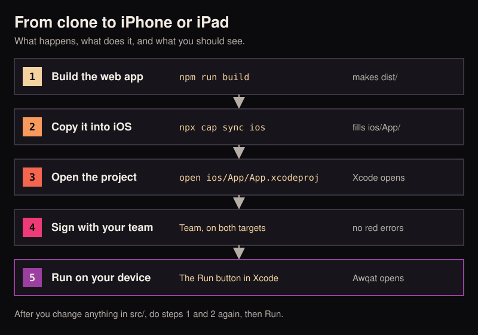
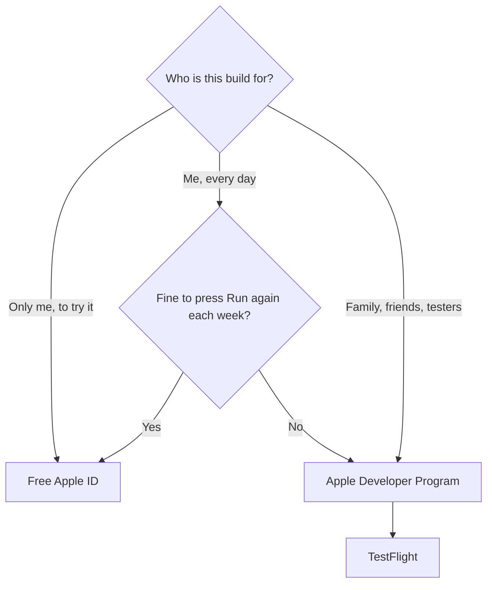
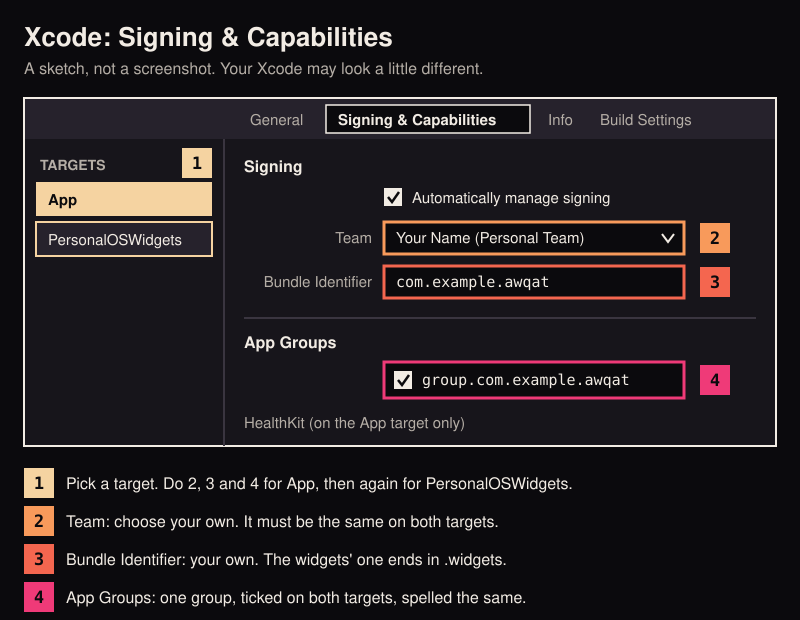
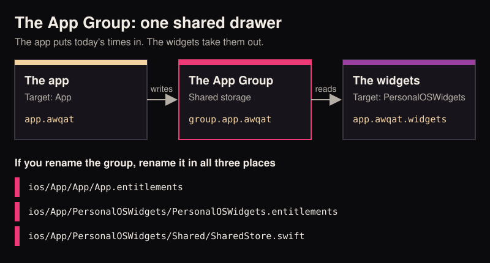

# 03 iPhone and iPad

By the end of this guide Awqat is running on your iPhone or iPad, with its widgets, built by you from the source.

Do [01 Run it](01-run-it.md) first. This guide starts where it ends: the code is on your Mac, `npm ci` has run, and
`npm run build` works.

<p align="center">
  
</p>

## Before you start

| You need | Why | Where |
|---|---|---|
| A Mac | Apple's build tools run only on macOS | |
| Xcode | Apple's app for building iPhone and iPad apps. Capacitor 8, which Awqat uses, asks for Xcode 26 or newer | [The Mac App Store](https://apps.apple.com/app/xcode/id497799835) |
| An iPhone or iPad on iOS 17 or newer | Awqat's lowest supported version | |
| An Apple ID | To sign the app. A free one works | The one you already use on the phone is fine |
| A cable from the device to the Mac | For the first install | |

You do not need CocoaPods or any other extra tool. The project gets its native libraries through Swift Package
Manager, which is built into Xcode.

Xcode is a large download. Start it early. Open it once after installing and let it add the iOS platform when it
asks.

## Free Apple ID or paid developer account

Both can put Awqat on your own device. The difference shows up a week later.

| | Free Apple ID | Apple Developer Program |
|---|---|---|
| Cost | Nothing | A yearly fee, see [Apple's page](https://developer.apple.com/programs/) |
| Run on your own device | Yes | Yes |
| How long an install lasts | 7 days. Then the app will not open until you press Run in Xcode again | A year |
| App Groups and HealthKit, which Awqat uses | Yes | Yes |
| TestFlight, to share with others | No | Yes |
| The App Store | No | Yes |



With a free Apple ID your records stay on the device when the 7 days run out. Plug in, press Run, and the app opens
again with everything in place, as long as you did not delete it.

## Part 1: open the project

### 1. Copy the web app into the iOS project

In Terminal, inside the `awqat` folder:

```bash
npm run build
npx cap sync ios
```

`cap` is Capacitor, the tool that wraps the web page in a phone app. `sync` copies the `dist` folder into `ios/App/`.

You should see a list of steps with ticks, ending in `Sync finished`.

### 2. Open it in Xcode

```bash
open ios/App/App.xcodeproj
```

You should see Xcode open with a project named App in the left column. At the top it says "Resolving Package Graph"
for a little while as it reads the libraries. Wait for that to finish.

### 3. Add your Apple ID to Xcode

In the menu bar choose Xcode, then Settings, then Accounts. Press the plus button, choose Apple ID, and sign in.

You should see your Apple ID in the list, with a team under it. For a free Apple ID the team is your name followed by
"(Personal Team)".

## Part 2: signing, the step everyone trips on

Signing stamps the app with your identity, so the device knows who built it. An iPhone refuses to run an app that is
not signed.

Awqat is two programs in one project. Xcode calls each a **target**:

- **App**: the app itself.
- **PersonalOSWidgets**: the widgets, the Lock Screen pieces and Live Activities. Apple calls this an extension.

Each target is signed on its own. **Everything in this part is done twice, once per target.** Setting only the first
one is the most common reason the build fails.

<p align="center">
  
</p>

### 4. Find the signing panel

Click the blue App icon at the very top of the left column. In the middle of the window a list named TARGETS appears.
Click **App** in that list, then the **Signing & Capabilities** tab above.

You should see a Signing section with a tick box, "Automatically manage signing", and a Team menu that says None.

### 5. Set your team, on both targets

With the App target selected, open the Team menu and choose your team. Then click **PersonalOSWidgets** in the
TARGETS list and choose the same team there.

You should see the Team menu show your team on both. Red error text may still show under it. The next two steps
clear it.

### 6. Give both targets your own bundle identifier

A bundle identifier is the app's unique id in Apple's world. It is written backwards like a web address. Each one can
belong to a single Apple team, and `app.awqat` is the project's, not yours. So pick your own. If you own a domain,
use it backwards. If not, anything unlikely to clash will do, such as your GitHub user name.

In the examples below, `com.example` stands for your part.

| Target | It says | Change it to |
|---|---|---|
| App | `app.awqat` | `com.example.awqat` |
| PersonalOSWidgets | `app.awqat.widgets` | `com.example.awqat.widgets` |

The widgets' id must be the app's id with `.widgets` added. Xcode refuses the build otherwise.

You should see the new id in the Bundle Identifier field on each target.

### 7. Give both targets your own App Group

<p align="center">
  
</p>

An app and its widgets are separate programs, and iOS keeps their storage apart. An App Group is a shared drawer
both can open. The app puts today's prayer times in. The widgets take them out. Like a bundle identifier, a group's
name can belong to a single team, so you need your own.

Do this on the App target, then again on PersonalOSWidgets:

1. On the Signing & Capabilities tab, scroll to the App Groups section.
2. Press the plus button under the list and type your group, for example `group.com.example.awqat`. It must start
   with `group.`.
3. Tick your new group. Untick `group.app.awqat`.

Then change one line of code so the app and widgets look in your drawer. Open
`ios/App/PersonalOSWidgets/Shared/SharedStore.swift` and find:

```swift
private static let group = "group.app.awqat"
```

Change the text in quotes to your group, spelled the same as in step 2.

You should see no red text left under Signing on either target. Xcode shows "Xcode Managed Profile" beside
Provisioning Profile.

This is the smallest change that gets the app onto your device. Renaming everything properly, Android included, is
in [04 Make it yours](04-make-it-yours.md) and in the list in [CONTRIBUTING.md](../../CONTRIBUTING.md).

## Part 3: run on your device

### 8. Get the device ready

1. Connect the iPhone or iPad to the Mac with the cable and unlock it.
2. If it asks "Trust This Computer?", tap Trust and enter the passcode.
3. Turn on Developer Mode: on the device open Settings, then Privacy & Security, then Developer Mode. Switch it on.
   The device restarts and asks you to confirm. Apple describes it in
   [Enabling Developer Mode on a device](https://developer.apple.com/documentation/xcode/enabling-developer-mode-on-a-device).

The Developer Mode row may not appear until the device has been plugged into a Mac running Xcode once.

You should see your device's name in the menu at the top centre of the Xcode window, beside the word App.

### 9. Run

Choose your device in that menu, then press the Run button, the triangle at the top left.

The first build takes a few minutes. You should see "Build Succeeded", then the app is copied to the device.

### 10. Trust yourself, once

With a free Apple ID, the first launch is blocked with "Untrusted Developer". On the device open Settings, then
General, then VPN & Device Management. Tap your Apple ID under Developer App, then Trust.

Press Run in Xcode again. You should see Awqat open on the device. It asks for your rough location and for
notifications. Both are optional.

### 11. Add a widget

Hold a finger on an empty spot of the Home Screen, tap Edit or the plus button, and search for Awqat.

You should see Awqat's widgets, and after you add one, the next prayer with a countdown. If the widget stays empty,
see the errors table below.

That is the whole loop. When you change something in `src/`, run `npm run build` and `npx cap sync ios`, then press
Run again.

## No device to hand: the Simulator

The Simulator is a pretend iPhone on your Mac. It needs no Apple ID and no signing changes. In the device menu at the
top of Xcode choose any iPhone under iOS Simulators, then press Run.

It is good for a look at the screens. It has no real health data, and a microphone and camera only as far as your
Mac provides them. Apple's guide:
[Running your app on simulated or physical devices](https://developer.apple.com/documentation/xcode/running-your-app-on-simulated-or-physical-devices).

## TestFlight, in short

TestFlight is Apple's way to send a test build to other people's phones. It needs the paid Apple Developer Program.

1. Finish [04 Make it yours](04-make-it-yours.md) first. A build you hand to others must carry your own name and ids.
2. On [App Store Connect](https://appstoreconnect.apple.com) create a new app, and choose the bundle identifier from
   step 6.
3. In Xcode, set the device menu to "Any iOS Device (arm64)". Choose Product, then Archive.
4. When the archive window opens, press Distribute App and choose the TestFlight option. Xcode uploads the build.
5. On App Store Connect, open the TestFlight tab, wait for the build to finish processing, and add your testers.

You should see the build listed under TestFlight, and your testers get an email inviting them to install it through
the TestFlight app.

For the command line, `ios/ExportOptions.plist` holds the upload settings. Put your own team id where it says
`YOUR_TEAM_ID`. The `xcodebuild` line that uses it is in a comment at the top of that file.

Two things to do before you share a build:

- If you turned on Talk or sync, update the two `PrivacyInfo.xcprivacy` files to match, as the
  [README](../../README.md) says under Privacy.
- A build that shows the mushaf is covered by Quran Foundation's developer terms. Read them.

More from Apple: [TestFlight](https://developer.apple.com/testflight/).

## Common errors

| You see | What to do |
|---|---|
| `Signing for "App" requires a development team` | Step 5. Set the team on App. |
| `Signing for "PersonalOSWidgets" requires a development team` | Step 5 again, on the second target. |
| `Failed to register bundle identifier` | The id is taken by another team. Step 6: choose your own. |
| `Embedded binary's bundle identifier is not prefixed with the parent app's bundle identifier` | The widgets' id must be the app's id plus `.widgets`. Step 6. |
| An error that mentions App Groups or a provisioning profile that "doesn't include" the group | Step 7. The same group must be ticked on both targets. |
| The app runs but every widget is empty | The group is spelled three different ways. Check both targets and `SharedStore.swift`. Then open the app once so it can fill the drawer. |
| `Untrusted Developer` on the device | Step 10. |
| `Developer Mode disabled` | Step 8. |
| Xcode says the device's iOS version is lower than the deployment target | The device is on iOS 16 or older. Awqat needs iOS 17. |
| `Missing package product` or packages that will not resolve | Run `npm ci` in the `awqat` folder. The packages are read from `node_modules`. Then in Xcode choose File, Packages, Reset Package Caches. |
| The app shows your old version | You skipped the build or the sync. Run `npm run build` and `npx cap sync ios`, then Run. |
| The app will not open a week later | A free Apple ID's 7 days ran out. Plug in and press Run again. |
| `Could not find the web assets directory: ./dist` | Run `npm run build` before `npx cap sync ios`. |

## Next

- Change the name, icon and ids everywhere: [04 Make it yours](04-make-it-yours.md).
- Widgets, Live Activities and the Dynamic Island, and how they are fed: [docs/live-surfaces.md](../live-surfaces.md).
- Let an agent run these steps with you: [05 With a coding agent](05-with-a-coding-agent.md).
