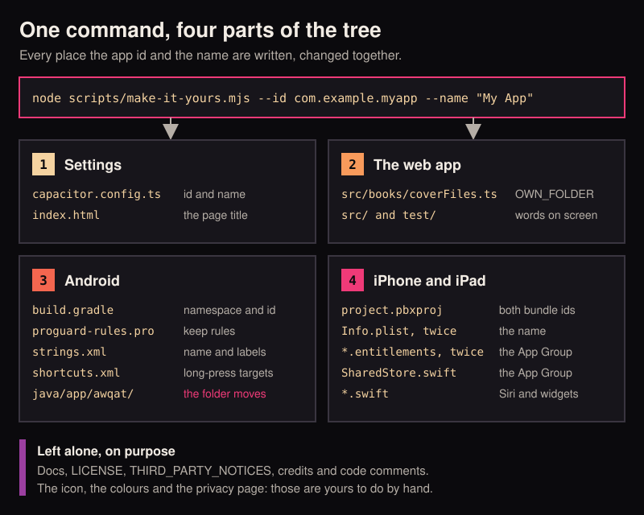
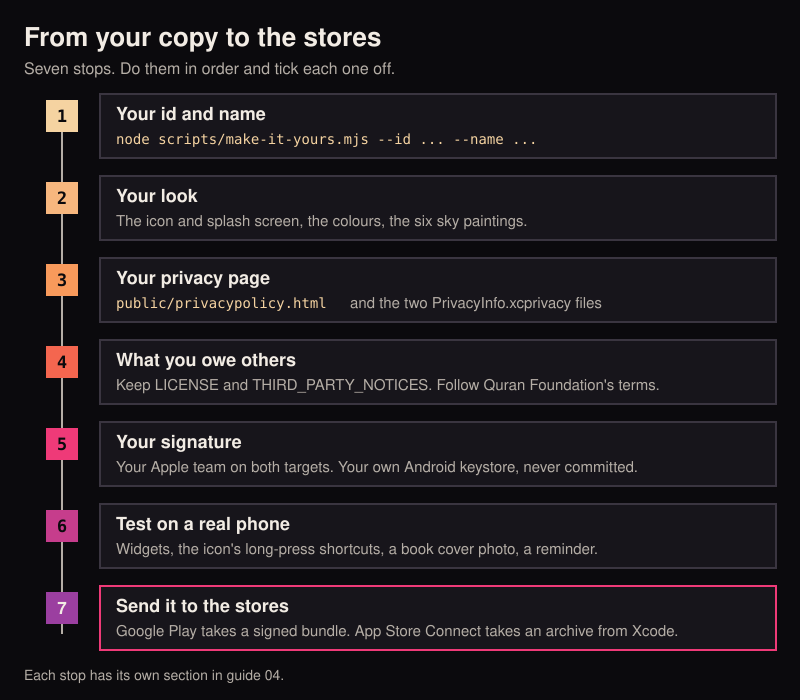

# 04 Make it yours

By the end of this guide the app carries your own name and your own app id, and you know what is left to do by hand
before it can go to a store.

Do [02 Android](02-android.md) or [03 iPhone and iPad](03-iphone-ipad.md) first. This guide starts where they end:
the app builds and runs on your phone under its original name.

<p align="center">
  
</p>

## Why this needs a tool

Two things identify an app.

- The **app id** is a name only machines read, written backwards like a web address: `app.awqat`. A phone and a store
  tell apps apart by it. Two apps with the same id cannot sit on one phone, and a store takes each id once.
- The **name** is what people read under the icon: Awqat.

The id is written in more than twenty files. Miss one and nothing warns you: the long-press shortcuts open nothing, or
the widgets stay empty, or camera photos pile up. So one command changes them all together, and stops before touching
anything if a place it expects is not there.

## Before you start

| You need | Why |
|---|---|
| Node 22 or newer | The same one guide 01 installed. Type `node --version` to check |
| Your changes committed | So this one change can be undone on its own. Type `git status`. It should say "nothing to commit" |
| An id of your own | If you own a domain, turn it round: `example.com` becomes `com.example.myapp`. If you do not, `io.github.yourname.myapp` is a common choice |
| A name of your own | 1 to 30 characters. Not a word the app already shows, such as Talk or Quran (the command tells you if it is) |

Rules for the id: at least two parts with dots between them, lowercase letters, digits and underscores only, each
part starting with a letter. If you plan an iPhone build, leave out underscores: Apple does not allow them.

## The one command

### 1. Look first

`--dry-run` prints the plan and changes nothing.

```bash
node scripts/make-it-yours.mjs --id com.example.myapp --name "My App" --dry-run
```

You should see the old and new values, then a list of lines starting with `would change` and `would move`, and at
the end `Nothing was changed.`

### 2. Run it

```bash
node scripts/make-it-yours.mjs --id com.example.myapp --name "My App"
```

You should see the same list, now saying `changed` and `moved`, and a short list headed `Next:`.

### 3. Rebuild and check

```bash
npm run typecheck
npm test
npm run build
npx cap sync
```

You should see the tests pass, as they did before. The script renames the tests' own examples too, so they still
match the app.

Then build and run on your phone as in guide 02 or 03. You should see a second app, with your name under the icon,
beside the original. It starts empty, because a new id is a new app to the phone.

On an iPhone, open the project in Xcode first and set your team on both targets (guide 03, step 5). If Xcode shows
red text about the App Group, press the refresh arrow beside it under Signing and Capabilities, or untick the old
group and tick the new one.

### Before and after

With `--id com.example.myapp --name "My App"`:

| Where | Before | After |
|---|---|---|
| `capacitor.config.ts` | `appId: "app.awqat"`, `appName: "Awqat"` | `appId: "com.example.myapp"`, `appName: "My App"` |
| `index.html` | `<title>Awqat</title>` | `<title>My App</title>` |
| `android/app/build.gradle` | `namespace` and `applicationId` are `app.awqat` | both are `com.example.myapp` |
| `android/app/proguard-rules.pro` | `-keep class app.awqat.WidgetBridgePlugin` | `-keep class com.example.myapp.WidgetBridgePlugin` |
| The Java folder | `android/app/src/main/java/app/awqat/` | `android/app/src/main/java/com/example/myapp/`, with every `package` line to match. The Java tests move the same way |
| `strings.xml` | `app_name` Awqat, `package_name` `app.awqat`, "Talk to Awqat" | My App, `com.example.myapp`, "Talk to My App" |
| `shortcuts.xml` | `targetPackage="app.awqat"` | `targetPackage="com.example.myapp"`, and `targetClass` to match |
| `src/books/coverFiles.ts` | `OWN_FOLDER` matches `/app\.awqat/` | matches `/com\.example\.myapp/` |
| Xcode project | bundle ids `app.awqat` and `app.awqat.widgets` | `com.example.myapp` and `com.example.myapp.widgets` |
| Both `.entitlements` files and `SharedStore.swift` | App Group `group.app.awqat` | `group.com.example.myapp` |
| Both `Info.plist` files | display name Awqat, and "Awqat" in the permission texts | My App |
| Siri, the Control Center button, the Quick Settings tile | "Talk to Awqat" | "Talk to My App" |
| Words on screen in `src/` | "Allow the camera for Awqat..." | "Allow the camera for My App..." |
| Links such as `awqat://go/faith` | `awqat://` | `awqat://`, unless you pass `--scheme` |

### The options

| Option | What it does |
|---|---|
| `--id com.example.myapp` | Your app id |
| `--name "My App"` | Your name. Keep the quotes if it has a space |
| `--group group.com.example.shared` | Your own iOS App Group. Left out, it is `group.` and your id |
| `--scheme myapp` | Also change the link scheme, so widget and shortcut links read `myapp://go/...`. Left out, links stay `awqat://`, which works fine: the links never leave the phone |
| `--dry-run` | Print the plan, change nothing |
| `--force` | Run even with uncommitted changes, or in a folder with no git history |

Give at least one of `--id`, `--name`, `--group` or `--scheme`. Anything you leave out stays as it is.

### Changed your mind

The command reads the current id and name from the tree itself, so run it again with the new ones.

```bash
node scripts/make-it-yours.mjs --id com.example.better --name "Better"
```

To throw the whole change away instead, before you commit it:

```bash
git checkout . && git clean -fd android/app/src
```

### What it leaves alone, on purpose

The command is careful about the name. It changes "Awqat" only where a person using the app reads it. It does not
touch:

- `LICENSE` and `THIRD_PARTY_NOTICES.md`.
- The docs, `README.md`, `CONTRIBUTING.md` and `AGENTS.md`. They still say `app.awqat`. Edit them when you like.
- Code comments, and names inside the code such as `TalkToAwqatIntent`, the settings file `awqat_widget`, and the
  `AWQAT_KEYSTORE_PROPS` variable. Nobody using the app sees these, and they work under any id.
- `public/privacypolicy.html`. It is a statement you make, so you rewrite it yourself (see below).
- `package.json`. Its `name` is only a label for npm.
- The icon, the colours and the skies. Those are the next sections.
- The copies Capacitor makes inside `android/` and `ios/`. `npx cap sync` rewrites them.

One line the app shows does change: the foot of the Settings screen, "Awqat 0.19, open source (MIT)", becomes
"My App 0.19, open source (MIT)". The credits after it stay. If you want to say where your app came from, add
"based on Awqat" there, in `src/ui/views.ts`.

If the command prints "These lines still say the old name", open each line it lists and change the word by hand. It
reads strings one line at a time, and a string that runs over several lines can hide a word from it.

## By hand: the icon and the splash screen

Three Python scripts draw every picture of the brand. You change the drawing in one place and run them. Never edit
the pictures they make.

### 1. Install what they need, once

```bash
python3 -m pip install -r scripts/requirements.txt
```

You should see Pillow, fontTools and uharfbuzz install.

### 2. Change the mark

Open `scripts/brand.py`. The mark is a grid of squares, 15 wide and 16 tall, described near the top:

| Name in `brand.py` | What it is |
|---|---|
| `GROUND` | The colour behind the mark: the icon's background and the splash screen |
| `INK` | The colour of the arch |
| `DUSK` | The five colours of the five small squares, Fajr to Isha |
| `ARCH` | The arch, as a list of squares: column, row, width, height |
| `PRAYERS` | Where the five small squares sit |
| `TAGLINE_LEAD`, `TAGLINE_LIT`, `LINE` | The words on the README banner |

To use a different shape, replace the squares in `ARCH` and `PRAYERS`. To keep the shape and change its colours,
change `GROUND`, `INK` and `DUSK`.

The banner also draws the word `awqat` and "BUILT BY ITQAN" (in `banner_parts`). The banner is only for the README, so
it does not ship in the app. Change it when you write your own README.

### 3. Draw everything

```bash
python3 scripts/brand.py
python3 scripts/make-android-icons.py
python3 scripts/make-ios-icons.py
```

| Script | What it writes |
|---|---|
| `brand.py` | `brand/awqat-mark.svg`, `awqat-icon.svg`, `awqat-banner.svg` and `awqat-social.png` |
| `make-android-icons.py` | The launcher icons in `android/app/src/main/res/mipmap-*`, the status bar icon `ic_stat_orb.png`, the icon's background colour, and every `splash.png` |
| `make-ios-icons.py` | The 1024 px app icon and the launch image in `ios/App/App/Assets.xcassets` |

You should see no output and no error. Type `git status`: the picture files are listed as changed. Build and run, and
the new icon is on your phone.

If you would rather use a picture you already have, skip the scripts and replace those same files with your own at
the same sizes. App Store icons must have no transparency.

## By hand: the colours

The command has no colour option, because the colours are not in one place. The web page, the Android widgets and
the iOS widgets each keep their own copy, so change all three or the app ends up in two colours.

Search for the old value and replace every hit. In a terminal, `git grep -n -i "e2cc9a"` lists them.

**The app's main colours** are CSS variables at the top of `src/ui/app.css`, under `:root`:

| Variable | What it paints | Now |
|---|---|---|
| `--ink` | Text | `#f5f1ea` |
| `--soft`, `--muted` | Quieter text. The same colour as `--ink`, more see-through | `rgba(245, 241, 234, ...)` |
| `--accent` | The one warm colour: Friday, ticks, the count button | `#e2cc9a` |
| `--ground` | The background before a sky loads | `#0b0a0d` |
| `--glass`, `--glass-deep` | The cards over the sky | dark, see-through |
| `--hair`, `--hair-strong` | The thin lines | white, faint |

**The accent has copies.** After changing `--accent`, change these too:

| Where | What to look for |
|---|---|
| `src/ui/app.css` and `src/ui/mushaf.css` | `rgba(226,204,154,` (the accent, see-through). 226, 204, 154 is `#e2cc9a` as three numbers |
| `src/ui/voiceOrb.ts` | `GOLD` |
| `android/app/src/main/java/.../` (four files) | `0xFFE2CC9A` |
| `android/app/src/main/res/layout/widget_*.xml` | `#E2CC9A` |
| `ios/App/PersonalOSWidgets/Palette.swift` | `champagne` |

**The mushaf reader** has its own two sets in `src/ui/mushaf.css`, on `.reader.theme-paper` and
`.reader.theme-night`: `--page-ink` (the words), `--page-soft`, `--page-hair`, `--frame` (the page border),
`--page-ground` and `--bar-ground`.

**The background colour** `#0B0A0D` is also written in `capacitor.config.ts` (`backgroundColor`), in `index.html`
(`theme-color`), and in `GROUND` in `scripts/brand.py`.

Run `npm test` after, then look at the app, an Android widget and an iPhone widget side by side.

## By hand: the sky paintings

The six pictures behind the app are in `public/sky`: `fajr.jpg`, `morning.jpg`, `dhuhr.jpg`, `asr.jpg`,
`maghrib.jpg` and `isha.jpg`. The app shows the one for the time of day.

To use your own, replace the files and keep the six names. Each is a tall JPEG, 752 by 1344 pixels. Use pictures you
made or have the right to ship, and list them in `THIRD_PARTY_NOTICES.md` in place of the line about the originals.

Text sits on top of the sky, so check each one on a phone. If a bright picture makes the words hard to read, the
shade over it is set in `src/ui/app.css`: search for `data-sky`.

## By hand: the default place

Until a person sets their place, the app works out times for Makkah, says so on Home, and rings no reminders. That
place is one line in `src/place.ts`:

```ts
export const DEFAULT_PLACE: Place = { lat: 21.4225, lng: 39.8262, label: "Makkah", source: "default", at: 0, tz: "Asia/Riyadh" };
```

To change it, set the latitude, the longitude, the label and the time zone name. Run `npm test` after, because some
tests expect Makkah.

## What the licence asks of you

Awqat is under the MIT licence. You may change it, rename it, and sell it. It asks one thing:

- **Keep `LICENSE`**, with its copyright line, in your copy. You can add your own copyright line under the first.

And the parts that came from other people ask their own things:

- **Keep `THIRD_PARTY_NOTICES.md`** and keep it true. It lists every font, dataset and library and its licence. Add
  what you add, and remove what you remove.
- **Keep the credits on the Settings screen** for the same reason. The command leaves them alone.
- **Quran Foundation's developer terms apply to you** if you hand anyone a build that shows the mushaf. The page
  fonts and words come from Quran Foundation's servers. Their
  [developer terms](https://api-docs.quran.foundation/legal/developer-terms/) ask for an active Developer Console
  account of your own, ask you to keep the credit "Quran fonts provided by Quran Foundation", and do not allow the
  fonts to be offered apart from the app. Read them yourself before you publish. They can change.
- **The first rule of the house still stands**: no Quran text typed, generated or stored in the repository
  ([AGENTS.md](../../AGENTS.md)).

## Your own signature

A store, and a phone, trust an app by who signed it. The original's keys are not in the repository and never will
be. You make your own.

**iPhone and iPad.** In Xcode, set your team on both targets, App and PersonalOSWidgets, as in
[guide 03](03-iphone-ipad.md). For the command line, put your team id in `ios/ExportOptions.plist` where it says
`YOUR_TEAM_ID`. Publishing needs a paid Apple Developer membership.

**Android.** Make a keystore and a `keystore.properties` file as in [guide 02](02-android.md). Keep both out of git
(the `.gitignore` already does) and keep a backup somewhere safe. If you lose the keystore you can no longer update
your app.

## Before you publish

<p align="center">
  
</p>

Tick each one.

**Your id and name**

- [ ] The command ran, and `npm test` and `npm run build` pass.
- [ ] `npx cap sync` ran after it.
- [ ] `git grep "app\.awqat" -- android ios src capacitor.config.ts` prints nothing.

**Your look**

- [ ] Your own icon and splash screen are on the phone.
- [ ] The colours match in the app, on an Android widget and on an iPhone widget.

**Your privacy page**

- [ ] `public/privacypolicy.html` is rewritten in your name. It is shown inside the app, and it is your promise, not
      the original author's. Say who you are and how to reach you. If you add anything that sends data off the phone,
      say so there.
- [ ] The same page is on a public web address. Both stores ask for a link to it.
- [ ] The iOS privacy manifests are still true: `ios/App/App/PrivacyInfo.xcprivacy` and
      `ios/App/PersonalOSWidgets/PrivacyInfo.xcprivacy`. As shipped they say no tracking and nothing collected. If you
      add analytics, ads or an account, they must say so, and so must the App Store's privacy questions.
- [ ] The permission texts in `ios/App/App/Info.plist` (the lines ending in `UsageDescription`) still describe what
      your build does.
- [ ] Google Play's Data safety form is filled in to match. The app reads Health Connect, which Play asks you to
      declare.

**What you owe others**

- [ ] `LICENSE` and `THIRD_PARTY_NOTICES.md` are still in the repository and still true.
- [ ] You have read Quran Foundation's developer terms and have your own account with them.
- [ ] No adhan recording is in the repository unless its licence allows it ([docs/adhan.md](../adhan.md)).

**Your signature**

- [ ] Your Apple team is set on both targets, and the App Group is registered to it.
- [ ] Your Android keystore exists, is backed up, and is not in `git status`.

**A test on a real phone**

- [ ] The app opens under your name.
- [ ] A widget fills in after you open the app once.
- [ ] A long press on the icon shows Talk, Adhkar and Read Quran, and each opens the app.
- [ ] A prayer reminder rings.

**The stores**

- [ ] The version is yours: `versionCode` and `versionName` in `android/app/build.gradle`, the version and build in
      Xcode, and `version` in `package.json`.
- [ ] Android: `cd android && ./gradlew bundleRelease` makes a signed `.aab` for Google Play.
- [ ] iPhone: Product, Archive in Xcode, then Distribute App.

## If something goes wrong

| What you see | What to do |
|---|---|
| `There are uncommitted changes` | Commit or stash your work first, so the rename can be undone on its own. Or add `--force`. |
| `This folder has no git history of its own` | You downloaded a ZIP rather than cloning. Add `--force`, and keep a copy of the folder first. |
| `... is not a valid part of an id` | Use lowercase letters, digits and underscores, each part starting with a letter: `com.example.myapp`. |
| `... is a Java keyword` | A part of the id is a word Java keeps, such as `new`, `int` or `class`. Pick another word. |
| `... is already a word the app shows` | The name you chose, such as Talk or Today, is already on a button or label. A later rename could not tell them apart. Pick another name. |
| `The id ... is already written in ...` | The id belongs to a library the app uses. Pick an id of your own. |
| `could not find ...` and `Nothing was changed.` | The file it names was edited or moved since this tool was written. Nothing was touched. Change the id by hand in the places [CONTRIBUTING.md](../../CONTRIBUTING.md) lists, or fix the tool. |
| `--accent is not applied by this script` | See "By hand: the colours" above. |
| `... is a symbolic link` | The tool never follows links out of the folder. Replace the link with the real file. |
| Android: `INSTALL_FAILED_UPDATE_INCOMPATIBLE` | An older copy under your new id, signed with another key, is on the phone. Uninstall it first. |
| Android: the long-press shortcuts open nothing | `npx cap sync` was skipped, or `shortcuts.xml` was edited by hand. Run the command again with `--dry-run` and read what it says. |
| iPhone: the widgets are empty | The App Group does not match in all three places, or it is not registered to your team. Check Signing and Capabilities on both targets. |
| iPhone: `Failed to register bundle identifier` | Another team has that id. Run the command again with a different `--id`. |
| Tests fail after the rename | Run `git diff test/` and read what changed. If you edited tests by hand before, the tool may not have matched them. |

## What this tool cannot check for you

It renames text. It does not build anything. After it runs, the proof is a build: `npm run build`, then the Android
build, then the iOS app and its widgets in Xcode.

## Next

- Let an agent do these steps with you: [05 With a coding agent](05-with-a-coding-agent.md).
- How the widgets and the lock screen are fed: [docs/live-surfaces.md](../live-surfaces.md).
- The rules every change keeps: [AGENTS.md](../../AGENTS.md).
