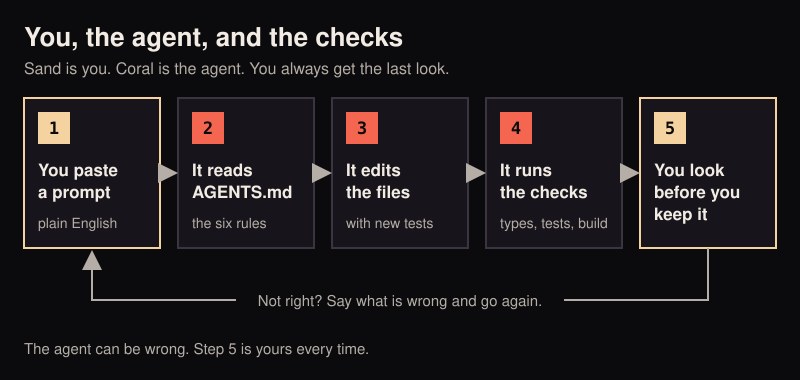
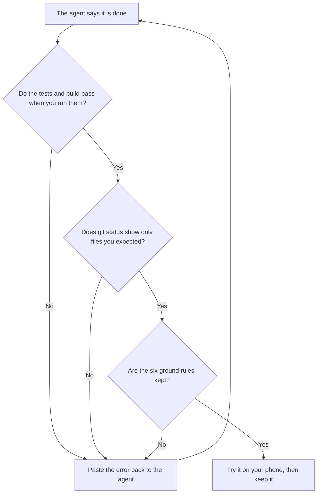

# 05 With a coding agent

A coding agent is an AI program that reads a repository, runs commands and edits files for you, from instructions in
plain English. Claude Code, Codex and Cursor are three of them. You can use one to build Awqat, change it, or explain
it, without writing code yourself.

Awqat was built this way. It also has a file written for agents, [AGENTS.md](../../AGENTS.md), so a new agent starts
with the rules instead of guessing them.

<p align="center">
  
</p>

## What AGENTS.md gives the agent

| Part | What it tells the agent |
|---|---|
| Ground rules | The six promises it may never break: no Quran text typed, nothing leaves the phone, no personal data, licences first, no streaks, motion is optional |
| Commands | How to install, test and build |
| How the code is laid out | Which folder holds what |
| The house style | How code, comments and on-screen words are written here |
| Adding a feature, step by step | The six steps every new feature follows |

## Set up

### 1. Get the code

Follow steps 1 and 2 of [01 Run it](01-run-it.md): install Node and Git, then clone the repository. The agent can do
the rest.

### 2. Install an agent

Pick one. Each has its own install page and needs its own account.

- Claude Code: [code.claude.com/docs](https://code.claude.com/docs/en/overview)
- Codex: [github.com/openai/codex](https://github.com/openai/codex)
- Cursor: [cursor.com](https://cursor.com)

### 3. Open it inside the awqat folder

For Claude Code and Codex, open a terminal, type `cd awqat`, then start the agent there. For Cursor, choose Open
Folder and pick `awqat`.

You should see the agent waiting for your first message, with the `awqat` folder named somewhere on screen.

### 4. Point it at AGENTS.md

- **Claude Code** reads it by itself. The repository's `CLAUDE.md` pulls in `AGENTS.md`.
- **Codex** looks for a file named `AGENTS.md` by itself.
- **Cursor and any other agent**: start your first message with "Read AGENTS.md first."

It never hurts to say it. Every prompt below starts that way.

## Prompts you can paste

Replace the words in CAPITALS with your own.

### See that everything works

```
Read AGENTS.md first. Then run npm ci, npm run typecheck, npm test and npm run build.
Change no files. Tell me in plain words what passed, what failed, and what I should do next.
```

### Show me the app in a browser

```
Read AGENTS.md and docs/guides/01-run-it.md. Build the app and start a preview I can open
in my browser. Give me the address. Tell me which parts will not work in a browser.
```

### Build me the Android APK

```
Read AGENTS.md and docs/guides/02-android.md. Check that I have JDK 21 and the Android SDK.
If something is missing, stop and tell me exactly what to install. Then run npm run apk
and tell me the full path of the APK file. Change no source files.
```

### Get it onto my iPhone

```
Read AGENTS.md and docs/guides/03-iphone-ipad.md. Run the build and npx cap sync ios, then
open the Xcode project. Walk me through the signing steps one at a time and wait for me
after each. My bundle identifier will be COM.EXAMPLE.AWQAT.
```

### Change the name and colours

```
Read AGENTS.md and docs/guides/04-make-it-yours.md. Run scripts/make-it-yours.mjs with
--dry-run first and show me its plan, then run it for real: the name is MY APP NAME and
the app id is COM.EXAMPLE.MYAPP. Change the colours the way guide 04 says, to #HEXCODE.
Then run typecheck, the tests and the build, and list every file that changed.
```

### Add a feature

```
Read AGENTS.md. Add a habit tracker card to Home, following "Adding a feature, step by
step". I want to name a few habits and tick each one off once a day. Ground rule 5
applies: no streaks, no scores. Write the tests first. When typecheck, the tests and the
build all pass, tell me what you built and what you could not check.
```

### Add my currency

```
Read AGENTS.md. Money works in AED and USD. Add CURRENCY CODE as a third currency, the
same way those two are done, with tests. Use round, made-up amounts in the tests.
```

### Explain before I change anything

```
Read AGENTS.md. Do not change any files. Explain, for someone who does not code, what
happens between my tap on the tasbih counter and the number going up. Name the files.
```

### Fix something I saw

```
Read AGENTS.md. On SCREEN NAME, when I DO THIS, I see THIS, but I expected THAT.
Find the cause, write a test that fails because of it, fix it, and show me the test
passing.
```

## How to ask well

- **One thing at a time.** A small request gives a small change you can read.
- **Say what you see and what you wanted.** "The card is cut off on my small phone" beats "fix the layout".
- **Ask it to stop and ask.** "If you are unsure, ask me before changing anything" saves undoing.
- **Ask for a plan first** on anything big: "Tell me your plan and wait for my yes."

## What to check after

The agent can be wrong and still sound sure. These checks are yours.



### 1. Run the checks yourself

```bash
npm run typecheck
npm test
npm run build
```

You should see no type errors, every test passed, and a build that finishes. Do not take the agent's word for it.

### 2. Look at what changed

```bash
git status
git diff --stat
```

`git status` lists every file that was changed or added. `git diff --stat` shows how much each one changed.

You should see only files that make sense for what you asked. A small text change should not touch thirty files.

### 3. Check nothing secret is in there

In the `git status` list you should not see a `.jks` or `.keystore` file, `keystore.properties`, `.env.local`, or
anything under `dist/`. The repository's `.gitignore` leaves these out. An agent should never add them by force.

Never paste a password, a keystore password or an API key into the chat.

### 4. Ask the six questions

Ask the agent, or look yourself:

1. Did it type or generate any Quran text, anywhere, tests included? It must not.
2. Did it add a new network call or any analytics? If so, why, and is it in the README's Privacy section?
3. Did it use a real name, email or place in tests? It should use made-up ones.
4. Did it add a font, image, sound or dataset? Then its licence belongs in `THIRD_PARTY_NOTICES.md`.
5. Did it add a streak, a score or a nudge built on guilt? Take it out.
6. Does anything new move on screen? It must stay still when the phone is set to reduce motion.

### 5. Ask what it could not check

```
What could you not check? A real device, the widgets, the microphone, anything else?
```

An honest agent has a list. Those are the things to try by hand.

### 6. Try it on a phone

A feature is done when you have used it on a real device. Build and run with [02 Android](02-android.md) or
[03 iPhone and iPad](03-iphone-ipad.md).

## If the agent made a mess

- Tell it: "Undo your last change and explain what went wrong."
- Still wrong? Before your next try, ask it: "Show me every uncommitted change, then put the files back as they were
  at the last commit." Read its answer before you say yes. This throws away work that was not committed.

A good habit: commit when things work, before you ask for the next change. A commit is a saved point you can always
return to. Ask the agent: "Commit this with a short message."

## Next

- The rules in full: [AGENTS.md](../../AGENTS.md).
- Before sending a change back to the project: [CONTRIBUTING.md](../../CONTRIBUTING.md).
- Back to the index: [Start here](README.md).
