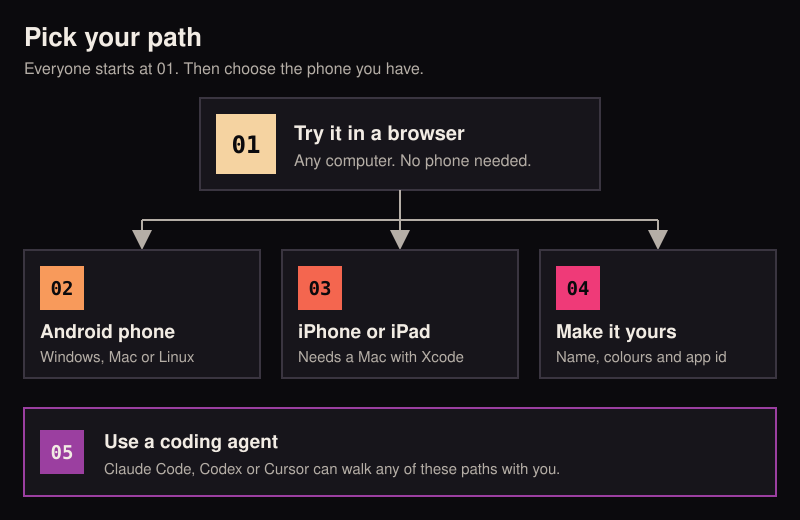
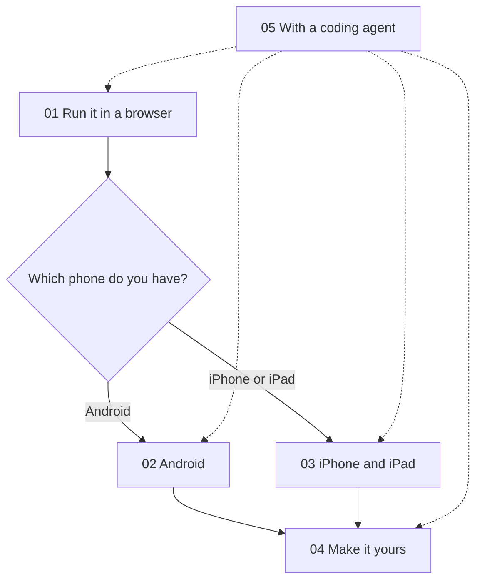
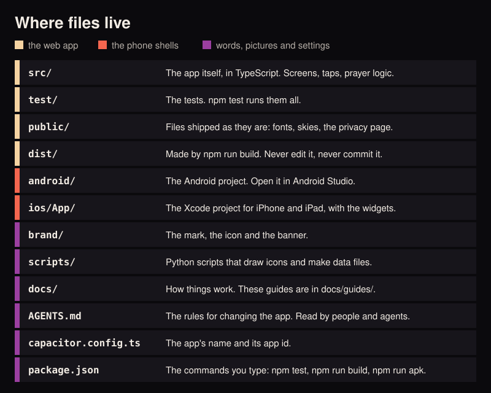

# Start here

These guides take you from nothing to Awqat running in front of you. They are written for people who have never built
an app. Every step says what you should see when it worked.

  

## Pick your path

| Guide | You want to | You need |
|---|---|---|
| [01 Run it](01-run-it.md) | See Awqat in a browser on your computer | Any computer |
| [02 Android](02-android.md) | Put it on an Android phone | Guide 01 done, an Android phone, a USB cable |
| [03 iPhone and iPad](03-iphone-ipad.md) | Put it on an iPhone or iPad | Guide 01 done, a Mac with Xcode |
| [04 Make it yours](04-make-it-yours.md) | Change the name, the colours and the app id | Guide 02 or 03 done |
| [05 With a coding agent](05-with-a-coding-agent.md) | Let Claude Code, Codex or Cursor do the typing | Guide 01 helps, but is not a must |

Do guide 01 first. Guides 02 and 03 both start where it ends.

## Words these guides use

- **Terminal**: the window where you type commands. On a Mac it is the Terminal app. On Windows, use Git Bash, which
  comes with Git (see guide 01 for why).
- **Repository**, or repo: the folder that holds all of Awqat's files and their history.
- **Clone**: to copy the repository from GitHub to your computer.
- **Build**: to turn the source files into something that can run.
- **APK**: the file an Android phone installs an app from.
- **Sign**: to stamp an app with a key that says who made it. Phones refuse apps that are not signed.

## Where files live

You do not need to know the code to follow these guides. This map is here so the folder names in them mean something.

  

One idea explains most of it. Awqat is a web page (`src/`) wrapped in a thin phone app (`android/` and `ios/`). The tool
that does the wrapping is called Capacitor. So every phone build has the same three moves: build the page, copy it
into the phone project, then build the phone app.

## The rules of the house

Awqat makes a few promises to the people who use it. The full list is in [AGENTS.md](../../AGENTS.md). The short
version:

1. No Quran text is typed, generated or stored in the repository.
2. Nothing leaves the phone unless the user set it up.
3. No personal data in code or tests.
4. Nothing is added without a licence that allows it.
5. No streaks, scores or guilt.
6. Motion is optional.

If you change the app, by hand or with an agent, keep these.

## If you get stuck

Each guide ends with a list of common errors and what to do. If yours is not there, copy the exact error text and
search for it, or paste it to a coding agent with guide 05.
